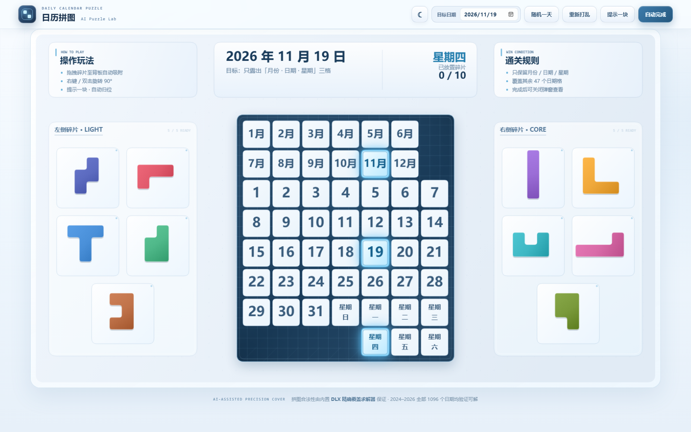
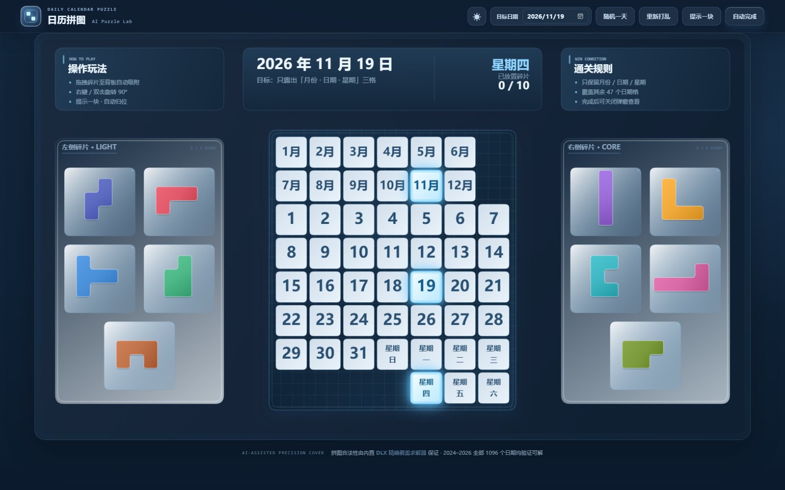

# 日历拼图 · Daily Calendar Puzzle

一个按「当天日期」自动出题的日历拼图小游戏：拖拽 10 块形状各异的拼图，盖住除「月份 · 日期 · 星期」三个目标格之外的所有格子，即完成拼图。

基于 **Vue 3 + TypeScript + Canvas** 实现，内置 **DLX（Dancing Links）精确覆盖求解器**为每一天生成参考解，保证有解。

## 预览

| 浅色主题 | 深色主题 |
| :---: | :---: |
|  |  |

## 功能特性

- **每日自动出题**：默认以当天日期为目标，也支持手动选择任意日期、随机一天
- **拖拽吸附**：碎片拖到背板自动吸附到格子，拖出背板即放回托盘
- **旋转**：右键或双击碎片顺时针旋转 90°
- **辅助功能**：提示一块、自动完成、重新打乱
- **主题切换**：浅色 / 深色主题，选择记忆在 localStorage
- **高清渲染**：按 devicePixelRatio 缩放画布，高分屏不发虚
- **可解性保证**：内置 DLX 求解器，2024–2026 全部 1096 个日期验证可解

## 快速开始

环境要求：**Node.js 18+**（Vite 5）

```bash
# 安装依赖
npm install

# 启动开发服务器（默认 http://localhost:5173，自动打开浏览器）
npm run dev
```

## 构建与部署

```bash
# 类型检查 + 打包，产物输出到 dist/
npm run build

# 本地预览打包产物（默认 http://localhost:4173）
npm run preview
```

`vite.config.ts` 已配置 `base: './'`，打包产物可以直接部署到任意静态服务器，或 GitHub Pages 的子路径（如 `https://<user>.github.io/<repo>/`）而无需改配置。

### 部署到 GitHub Pages

```bash
npm run build
npx gh-pages -d dist      # 首次使用需先安装：npm i -D gh-pages
```

### 部署到其他静态托管

将 `dist/` 目录内容上传到 Nginx、Vercel、Netlify、对象存储等任意静态托管即可，无需后端服务。

### 使用 Docker 部署

项目内置多阶段构建的 `Dockerfile`（Node 构建 → Nginx 托管）：

```bash
# 构建镜像
docker build -t daily-calendar-puzzle .

# 启动容器：宿主机 8086 端口映射到容器 8086
docker run -d --name daily-puzzle -p 8086:8086 daily-calendar-puzzle
```

启动后访问 <http://localhost:8086> 即可。镜像内的 Nginx 已配置 gzip 压缩、静态资源长缓存与入口页不缓存（见 `nginx.conf`）。

## 玩法

1. 页面默认以**当天日期**为目标；也可以在顶栏选择目标日期，或点击「随机一天」。
2. 该日期的**月份格、日期格、星期格**会高亮显示，这三格需要保持露出。
3. 将左右托盘中的 10 块拼图拖到背板上，恰好盖住其余 **47 格**。
4. 操作方式：
   - 拖拽移动碎片，拖出背板即放回托盘
   - 右键 / 双击：顺时针旋转 90°
   - 「提示一块」：自动将一块碎片归位
   - 「自动完成」：一键放置全部碎片
5. 10 块碎片全部落位、互不重叠、且没有盖住任何目标格时，拼图完成。

## 规则与核心逻辑

### 棋盘布局

物理背板为 8 行 × 7 列，共 **50 个有效格**（row7 的 c0–c3 不在背板上）：

```
row0:  1月   2月   3月   4月   5月   6月
row1:  7月   8月   9月  10月  11月  12月
row2:   1    2    3    4    5    6    7
row3:   8    9   10   11   12   13   14
row4:  15   16   17   18   19   20   21
row5:  22   23   24   25   26   27   28
row6:  29   30   31  星期日 星期一 星期二 星期三
row7:   ·    ·    ·     ·   星期四 星期五 星期六
```

- 12 个月份格 + 31 个日期格 + 7 个星期格 = **50 格**
- 10 块拼图共 **47 格**，每局留出「月份 · 日期 · 星期」3 个目标格：47 + 3 = 50，恰好精确覆盖

### 拼图碎片

| 键 | 形状 | 格数 |
| --- | --- | :---: |
| Z4 | 2×2 Z 字形 | 4 |
| T5 | 3×3 T 字形 | 5 |
| Z5a | 2×3 Z 字形 | 5 |
| I4 | 1×4 竖条 | 4 |
| L4 | 3×1 L 形 | 4 |
| V5 | 3×3 L 形 | 5 |
| Z5b | 3×2 Z 字形 | 5 |
| L5 | 4×1 L 形 | 5 |
| Q5 | 2×3 长方形缺少左上 | 5 |
| U5 | 2×3 长方形缺少中下 | 5 |

合计 47 格；每块拼图支持去重后的 1–4 种旋转态。

### 求解与校验

- **出题**：`solveFor()` 使用 DLX 精确覆盖，求出覆盖全部 47 个非目标格的一组摆放（每块碎片恰好使用一次）；再把碎片随机旋转、放入两侧托盘，并避免初始旋转与参考答案完全相同。
- **放置校验**：`canPlace()` 要求碎片所有格都在有效范围内、不与其他碎片重叠、不覆盖目标格。
- **通关判定**：`isSolved()` 要求 10 块全部落位、互不重叠、未覆盖目标格，且覆盖格数恰好为 47。
- **可解性验证**：2024–2026 共 1096 个日期全部可解。

## 项目结构

```
src/
├── game/
│   ├── board.ts          # 棋盘布局、目标格索引、日期工具
│   ├── pieces.ts         # 10 种碎片形状、颜色与旋转去重
│   ├── solver.ts         # DLX 精确覆盖求解器
│   └── engine.ts         # 游戏状态机（出题 / 放置校验 / 胜负）
├── components/
│   └── GameCanvas.vue    # Canvas 渲染、拖拽吸附、旋转与提示交互
├── App.vue               # 页面外壳、顶栏、胜利弹层、主题切换
├── main.ts
└── style.css
```

## 技术栈

- Vue 3（Composition API + `<script setup>`）
- TypeScript
- Vite 5
- Canvas 2D（无第三方绘图 / 游戏引擎）

## 说明

- 「随机一天」的范围为 2024-01-01 至 2026-12-31；手动选择其他年份的日期同样使用同一套求解逻辑，但可解性验证以 2024–2026 为准。
- 截图位于 `docs/` 目录，更新界面后可自行替换。
